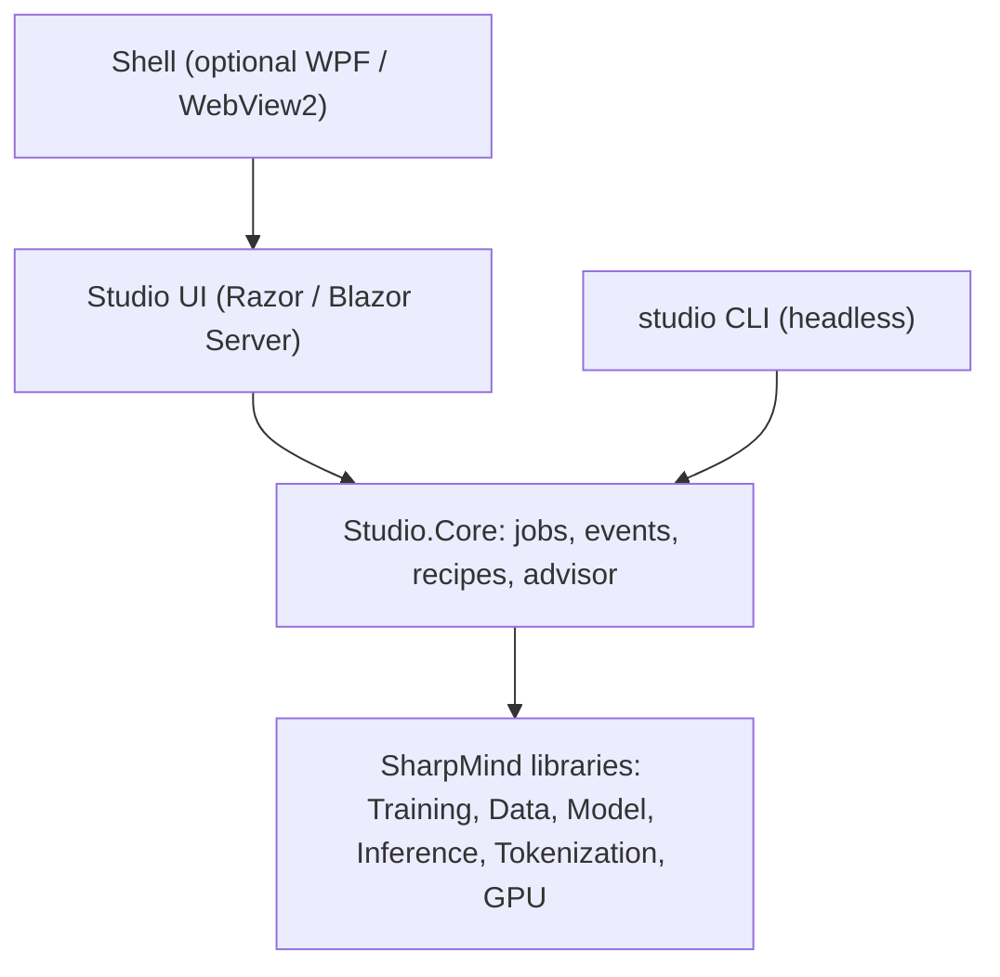
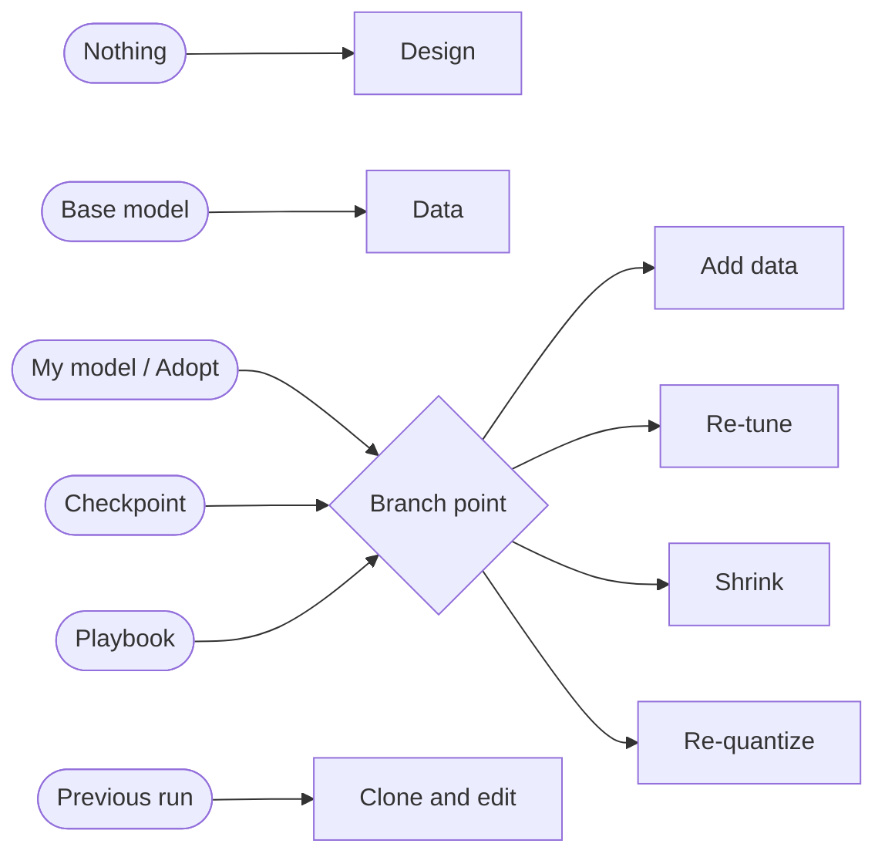

# SharpMind Studio - Design

> **Status:** implementation in progress, October 2026. Studio **1.1.0.0**.
> Built: shell, projects/runs/recipes, canary and tool probes, Chat lab, layered inference settings.
> Remaining: Work mode and the Training lab.
SharpMind Studio is a local-first application for chatting with models, doing project work with them, and building them: from scratch, from a base model, or by upgrading a model you already have. It is the successor to the terminal UI (CUI) as the primary front end, and it is meant to be something people want to use: attractive, calm and fast.

---

## 1. Principles

1. **One engine, three depths.** A novice, a practitioner and an expert all drive the same engine. Easy mode makes suggestions with reasons. Expert mode exposes every knob. Anything the GUI does is a saved, diffable, re-runnable **Recipe**.
2. **Every suggestion explains itself.** No magic defaults. Each recommendation carries a reason, its evidence and the alternatives it rejected.
3. **Honest about cost.** Time, memory and file-size estimates are shown before a run starts, and a short rehearsal run replaces guesses with measurements.
4. **Local-first.** Everything runs on the user's machine. No telemetry. Network access (model hub, remote teachers) is explicit and visible.
5. **Lineage is a feature.** Every artifact knows what produced it: base model, data, recipe, tokenizer.
6. **A clean break from the CUI.** Studio does not reference the CUI. The shared surface is the SharpMind libraries and the file formats, nothing else.

---

## 2. Modes

| Mode | For | What it is |
|---|---|---|
| **Chat** | Everyone | Pick a model, talk to it. Saved sessions, system prompt and tools drawer. Models carry a "runs well / runs slowly / won't fit" badge computed from the machine. |
| **Work** | Practitioners | Project spaces. Each project is a folder with its own system prompt, skills, tool permissions, memory, and `runs/` and `models/` directories. |
| **Training** | Builders | The lab for creating and improving models. Sections: **New model**, **Improve**, **Playbooks**, **Data**, **Runs**, **Models**. |

"Expert" is a per-field toggle, not a mode.

### Work mode sandboxing

- Tools are jailed to the project root, with per-project `Never / Ask / Always` permission profiles.
- Path jailing is **not** isolation for untrusted code. Running code safely needs an OS container, offered as an opt-in Docker/Podman tool plugin and labelled as the only true isolation.

---

## 3. Architecture



### Repository layout (separate repo)

```
SharpMind.Studio/
  global.json                  pin the .NET 10 SDK
  Directory.Build.props        own version (1.1.0.0); IsPackable=false by default
  Directory.Packages.props     central package versions
  SharpMind.References.props   project/package switch (below)
  nuget.config                 local feed + nuget.org
  src/SharpMind.Studio.Core    UI-free: job service, events, recipes, hardware advisor
  src/SharpMind.Studio         Razor UI + Kestrel host
  src/SharpMind.Studio.Shell   optional WPF/WebView2 window (Windows only)
  tests/SharpMind.Studio.Tests
```

- **UI:** Razor components on Blazor Server, hosted by a local Kestrel service. It opens in a browser, or inside the optional shell via `BlazorWebView`. The same UI therefore works locally and against a remote training box.
- **Shell** is a separate project so Core and the UI build and test on Linux CI.
- **Studio.Core stays UI-free** so runs work headless (`studio train recipe.smmtx`), are testable without a browser, and can be driven by any future client.
- **Security defaults:** the service binds to `127.0.0.1`. Remote access is an explicit opt-in with a token. Hub tokens are stored in the OS credential store, never in recipes.

### Referencing the library

Studio develops against the library in **project** mode and ships against it in **package** mode. A switch makes this a build flag instead of an end-of-project migration:

```xml
<!-- SharpMind.References.props -->
<Project>
  <PropertyGroup>
    <SharpMindSource  Condition="'$(SharpMindSource)'==''">project</SharpMindSource>  <!-- project | package -->
    <SharpMindRoot    Condition="'$(SharpMindRoot)'==''">$(MSBuildThisFileDirectory)..\SharpMind\</SharpMindRoot>
    <SharpMindVersion Condition="'$(SharpMindVersion)'==''">1.0.9.0-dev.1</SharpMindVersion>
  </PropertyGroup>
  <ItemGroup Condition="'$(SharpMindSource)'=='project'">
    <ProjectReference Include="$(SharpMindRoot)SharpMind.Training\SharpMind.Training.csproj" />
    <ProjectReference Include="$(SharpMindRoot)SharpMind.Data\SharpMind.Data.csproj" />
    <ProjectReference Include="$(SharpMindRoot)SharpMind.Model\SharpMind.Model.csproj" />
  </ItemGroup>
  <ItemGroup Condition="'$(SharpMindSource)'=='package'">
    <PackageReference Include="SharpMind.Training" Version="$(SharpMindVersion)" />
    <PackageReference Include="SharpMind.Data" Version="$(SharpMindVersion)" />
    <PackageReference Include="SharpMind.Model" Version="$(SharpMindVersion)" />
  </ItemGroup>
</Project>
```

Working rules:

- `SharpMindRoot` points at a **dedicated checkout** (a `git worktree` of the library's 1.0.9.0 branch) that is updated deliberately, never the live working copy.
- Library changes Studio needs land **first**, additive and tested, then get packed as a preview, then Studio bumps.
- **Public API only.** If Studio needs an `internal`, that is a signal for a public API, not for `InternalsVisibleTo`.
- CI builds Studio twice (project mode against library `main`, package mode against the last preview) so breaking library changes surface early.
- Check which library packages are actually published on nuget.org. Until they are, package mode uses a local feed.

---

## 4. Core concepts

### 4.1 Project

A folder: `project.json`, `data/`, `runs/`, `models/`, `evals/`, plus Work-mode settings. Paths come from one place in Studio.Core.

### 4.2 Recipe (`.smmtx`)

`.smmtx` replaces `.smmt`. A Recipe is a **step graph**, not a flat settings bag.

- `schemaVersion` and `$schema` from day one, with migrations.
- Components referenced by **stable IDs**, never assembly-qualified names (the cause of the `.smmt` version-bump breakage fixed in 1.0.7.0).
- A one-way, non-destructive `.smmt → .smmtx` migrator that writes a sibling file. The `.smmt` reader is kept for several versions.
- Steps are **content-addressed**: a step's identity is a hash of its type, parameters and input hashes.

Content addressing gives, for free: "run from here" and cheap experiments (upstream is cached), stale detection when data changes, lineage, playbooks as partial graphs, and branch-and-compare that share identical upstream steps. The library's existing `IncrementalPlanner` already does file-level delta detection, so this generalises something that exists.

Illustrative sketch (not final):

```json
{
  "schema": "smmtx/1",
  "name": "kiosk-assistant-v2.1",
  "playbook": { "id": "edge-standard", "version": 3, "overrides": ["steps.tune.rank", "steps.mix.replay"] },
  "deviceProfile": "kiosk-4gb-arm",
  "steps": [
    { "id": "data",  "type": "ingest",   "params": { "sources": ["client-docs/"] } },
    { "id": "clean", "type": "triage",   "needs": ["data"],  "params": { "dedupe": "near", "pii": "flag" } },
    { "id": "mix",   "type": "mix",      "needs": ["clean"], "params": { "replay": 0.2 } },
    { "id": "tune",  "type": "lora",     "needs": ["mix"],   "base": "models/v2#master", "params": { "rank": 16, "alpha": 32 } },
    { "id": "eval",  "type": "evaluate", "needs": ["tune"] },
    { "id": "pack",  "type": "quantize", "needs": ["tune"],  "params": { "targets": ["Q4_K", "Q8_0"] } }
  ]
}
```

### 4.3 Playbooks

A playbook is a versioned partial Recipe with **locked** fields (base, tokenizer, formatter, quant family) and **open** fields (data, steps, device). Tweaks are stored as a diff over the playbook ("EdgeStandard v3 + 3 overrides"), so a playbook update can merge cleanly.

### 4.4 Device Profile

What the model must run on: RAM, CPU/GPU, **storage read bandwidth and latency**, target tokens/s, maximum file size, context length. Storage matters because streaming MoE pays disk cost on expert cache misses. Studio measures it (a sequential-read benchmark) instead of asking.

### 4.5 Lineage and model versions

A **model version** is a float master (a checkpoint or F16 `.smm`) plus **derived quant builds** per device profile. Quantized builds are outputs and never training roots.

- If a user points at a quantized-only file, the wizard says so: fine-tuning works on the dequantised weights, but the quality ceiling is lower, so find or rebuild the master if possible.
- **Adopt** brings a pre-Studio `.smm` or GGUF in as a lineage root. Old `.smmt` jobs are imported through the migrator so the advisor knows what produced it.

### 4.6 Runs and the event stream

Every run emits one append-only stream, written to `runs/<id>/events.jsonl`. The training screen, history, replay and headless logs all derive from it.

```
RunStarted      { runId, recipeHash, baseModelHash?, device, startedUtc }
StepLogged      { step, loss, lr, gradNorm, tokensPerSec, tokensSeen, memBytes }
EvalCompleted   { step, valLoss, perplexity }
ExpertStats     { step, layer, counts[], routingEntropy }       // MoE only
CheckpointSaved { step, path, modelHash }
ProbeAnswered   { step, probeId, text }
RunFinished     { status, exportPath?, durationMs }
```

### 4.7 Layered settings

Settings resolve from **System -> Family -> Model -> Session**. Every downstream layer is sparse: `null` means inherit. The resolver returns both the effective value and the layer that supplied it, so the UI can show `0.6 (Qwen2 family)` rather than a bare number.

- System defaults are stored in `Studio\Studio\inference.json`.
- Families are detected from model metadata and are keyed by normalized architecture family.
- Models are keyed by full path, so moving a file deliberately resets its model-specific overrides.
- Session overrides live inside the chat document. Clearing them returns to the family/model/system chain.
- The same layering will later carry skills, tools and project settings.

### 4.8 Chat sessions

Chat stores one document per conversation under the project's `chats/` folder. Each document keeps the model path, family, messages, session overrides and a model fingerprint. The KV cache snapshot is stored separately and used on reopen when the model, formatter, generator and cache still match; otherwise the history is restored and the cache is rebuilt.

Chat output is plain text while streaming and sanitized Markdown when the turn completes. Raw HTML is disabled and links are restricted to http, https and mailto.

---

## 5. The Training lab

### 5.1 The Build Map

The lab is **not** a linear wizard. It is a graph of *moves* over a model lineage. You stand on a node (a model state, or nothing), say what you want changed, and the wizard proposes a path through the graph. The path is shown as a tree: chosen steps, ghosted alternatives, a reason on each, and "fork here" to branch variants.



**Starting points:** nothing, a base model (hub or local), a model of mine, a checkpoint (resume or branch), a playbook, a previous run, or **Adopt** an existing model.

**Goals** (multi-select): teach it new knowledge, change behaviour or style, make it better at what it does, make it smaller or faster, fit a device, add a capability (context, tool use, language), change architecture.

**Moves** and their stages:

| Move | Notes |
|---|---|
| Design | Shape, dense or MoE, layer layout, vocabulary |
| Formatter | Define, verify or convert the chat template ("dialect") |
| Tokenizer | Inherit, train new (reserving role tokens), or extend |
| Ingest / Triage / Synthesize / Mix / Split | Data stages, see section 6 |
| Pretrain / Continue / LoRA / SFT | Weight-changing training moves |
| Distill / Prune / QAT / Quantize | Compression moves |
| Merge | Adapters or models |
| Evaluate | After every weight-changing move |
| Package | `.smm` / `.gguf` plus report |

**Preconditions keep the tree flexible without making it free-for-all:** SFT needs a formatter and a tokenizer with role tokens; distillation needs a teacher and a student; fine-tuning needs loadable float weights; quantization comes last. A user may jump to any node whose preconditions hold, and the wizard fills in the rest.

### 5.2 Typical paths

| Start | Goal | Suggested path |
|---|---|---|
| Nothing | Narrow edge model (router, extractor, classifier) | Design → Formatter → Tokenizer → Data triage → Pretrain (small corpus) → SFT → QAT → Verify → Package |
| Base model | Tailor to a client | Data → Triage → Continue/LoRA with replay mix → SFT (if chat) → Verify → Quantize → Package |
| My model v2 (float master) | Upgrade with new data | Data delta → LoRA/continue from v2 → Compare vs v2 → Promote v2.1 → Re-quantize variants |
| My model (quantized only) | Upgrade | Warn → find or rebuild master → else LoRA on dequantised weights (lower ceiling) → Re-quantize |
| Checkpoint | Continue | Resume (same recipe) or Branch (change settings or data) |
| My model | Smaller, for a new device | Distill to a smaller student → QAT → Verify against the device profile |
| Playbook | New client | Fill open fields (data, device) → Run |
| Any model | Faster on this device | Re-quantize plan → threads and KV settings → Measure (no training) |

**From-scratch pretraining is gated by honest arithmetic.** Good small public models are trained on trillions of tokens; at roughly a thousand tokens per second (the class of throughput the README reports for a 135M model on GPU), 2B tokens takes about 20 days. From scratch therefore suits narrow-domain edge models where a small corpus is enough, and the wizard shows this calculation before the user commits.

### 5.3 What "upgrade" means

1. **From a point.** Pick any lineage node and choose *resume* (same recipe and optimizer state) or *branch*.
2. **Prefab settings, tweaked.** An **Upgrade Kit** is a playbook of improvement moves with sensible defaults, such as "add data and re-tune" with replay and a low LoRA rank.
3. **New training sets added.** The planner marks downstream steps stale and runs from the data node onward. It chooses between appending and rebuilding and explains why; for small or off-domain data it recommends replay mixing to reduce forgetting.

### 5.4 Wizard behaviour

1. **Intake in about six plain-language questions:** what the model does, where it runs, what data exists, what "good" looks like (a handful of example prompts), licence and privacy constraints.
2. **Three plans:** *Fast* (LoRA on a base), *Balanced* (continue, then SFT, then quantize), *Ambitious* (distill or scratch). Each shows time on this machine, size, risks and why it was suggested.
3. **Every suggestion is a rule result:** `{ value, reason, evidence, alternatives }`, for example *"360M dense, because your target has 2 GB free: weights ≈ 0.2 GB at Q4 plus KV cache at 2k context leaves headroom; 1B fits but misses your 8 tok/s target."* Rules are versioned data files with IDs, so they are testable and transparent.
4. **Three depths per field:** accept, adjust (guard-railed sliders with live estimates), or edit the raw Recipe.
5. **A live estimator rail:** memory, time, file size, tokens-per-parameter, risk flags.
6. **A rehearsal run** of about 30 steps measures real throughput, refines the ETA and catches pipeline errors before hours are committed.
7. **"Why can't I?"** on disabled options. For example, GPU training is currently LoRA-only, so a from-scratch run falls back to CPU, and the card says so with alternatives.

### 5.5 Improve: the diagnosis loop

**Diagnose → Hypothesise → Experiment → Compare → Promote.** Diagnosis reads run history and evals:

| Observation | Likely cause | First experiments |
|---|---|---|
| Val loss still falling at the end | Under-trained | More steps, restart at lower LR, better data |
| Train falls, val flat or rising | Overfit | Fewer epochs, more diverse data, lower LoRA rank |
| Spikes or NaN | LR too high or too little warmup | Lower LR, longer warmup, check clipping |
| Good val loss, poor answers | Format or masking issue | Check the formatter preview and SFT data |
| Q4 far worse than F16 | Quantization-limited | Per-tensor plan, QAT, more bits for embedding or output |
| Better in domain, worse in general | Forgetting | Mix in 10–30% general replay, lower LR |

Experiments run as short, comparable trials with the same seed and validation set. **Data experiments come first**, since data usually matters more than hyperparameters. A held-out "final exam" set is touched only on promotion, to avoid tuning to the validation set. *Promote* creates a new version with a changelog and a before/after report that doubles as the client upgrade pitch.

---

## 6. Data

### 6.1 Two triage tracks

- **Corpus triage** (pretraining and continued training): quality, near-duplicates, language, licence, PII, length, domain tags. The formatter plays no part; it is text and a token stream.
- **Instruction triage** (SFT): formatter-aware. Each example is rendered through the model's formatter, then checked for valid roles, length after rendering, correct loss mask, and contamination against the eval set.

### 6.2 The formatter belongs to the model

For a base model it is inherited and only verified. For from-scratch it is designed up front, because role tokens must be reserved when the tokenizer is trained: **formatter, then tokenizer, then pretraining**.

The **Formatter Designer** picks a template (ChatML, Llama 3, Gemma, custom Jinja) and shows a live preview of a rendered conversation with tokens coloured by whether they count toward the loss. One formatter object serves training, chat and the server, and is embedded in the `.smm`.

### 6.3 Data Factory (synthetic data from local models)

A local GGUF teacher, in-process or through the OpenAI-compatible server, can generate Q&A from client documents, rewrite or clean data, label and tag records, judge and filter examples, and produce teacher answers for distillation.

Guard rails:

- **Speed.** CPU decoding is a few tokens per second on modest hardware. 10,000 pairs of about 200 tokens is 2M tokens, roughly 55 hours at 10 tok/s. The estimator says so up front, and results are cached by prompt hash so runs are resumable.
- **Licence.** Each synthetic record stores the teacher model and its licence, with a warning when the terms may restrict training other models. This is a flag, not legal advice.
- **Model collapse.** Warn when synthetic data dominates a pretraining mix. In SFT it is normal, but real data should stay in the blend.
- **Human review.** A queue where 50 sampled records are approved, edited or rejected before the run.

---

## 7. Model design defaults

These are defaults with reasons, not laws. The wizard shows the reason and the alternatives each time.

- **Dense by default, MoE when the device suits it.** SharpMind's streaming mode does not need every expert resident. `MoEResidencyPlanner.SuggestResidentExperts` clamps pinned experts per layer to a memory budget (with 20% headroom), and cold experts load on demand per token's top-k. MoE memory therefore scales with *resident experts × layers*, not total experts. With top-k = 6, 6 resident experts per layer is the floor (fewer means every token touches storage) and about 2× is comfortable. MoE is attractive with fast storage and a narrow workload, and a poor choice on slow flash.
- **Locality versus balance (hypothesis to test).** The standard load-balancing loss pushes expert usage toward uniform, the opposite of what a cache wants. For edge-streaming MoE, offer a locality-aware recipe: weaker balancing plus domain-specialised experts. Verify measures the result.
- **Working-set curve.** Verify runs the client's probe prompts, records per-layer expert routing, and plots hit rate against resident-expert count, so `DesiredResidentExperts` is recommended from evidence. The measured "hot experts per layer" can ship in the package so the edge device starts with warm pins.
- **Deep and thin for small models.** SmolLM2-style shapes (about 30 layers at 576 hidden for 135M) tend to beat wide and shallow at this size.
- **Vocabulary as a parameter lever.** The embedding table can be a large share of a tiny model. Show its percentage, and allow a smaller vocabulary for narrow domains.
- **Context is a memory bill.** Show KV-cache memory per context length for the chosen shape.
- **Quantization with QAT.** Small models degrade more under heavy quantization, so below Q5 suggest QAT and a per-tensor plan.

### Training precision

- **F32 master** is the default (`QuantAwareTraining: null` in `.smmt`).
- **QAT target** (F16, Q8, Q4 and below) is described as a quality tool for export. In the library it is fake quantization: master weights, gradients and optimizer state stay F32, so memory does not drop, and backward stays F32. Q8 QAT is therefore not expected to be much faster; the ceiling is about 1.5× per step and 10–20% is realistic. The rehearsal run measures F32 against the chosen target on the user's machine.
- **Vocabulary multiples.** Q8_0 needs the vocab size to be a multiple of 32; K-quants need hidden size a multiple of 128 and vocab × hidden a multiple of 256. Studio validates this before starting and offers to pad the model vocab.
- **Later:** LoRA over a quantized frozen base, and 8-bit optimizer states for memory.

### Distillation, quantization, hub

- **Distillation:** *sequence-level* (a teacher generates text; the student does SFT; works across tokenizers and with any OpenAI-compatible endpoint) first; *logit-level* (KL with temperature, shared tokenizer, cached top-k teacher logits) later.
- **Quantization:** a sensitivity-aware plan (collect activations on a calibration set, measure perplexity change per tensor role, spend bits where they hurt least), with a Pareto chart of size versus quality and measured speed on this machine.
- **Hub client:** HttpClient only; search, resumable ranged download into the model cache, gated-licence display, dataset download. GGUF metadata sits at the start of the file, so a ranged request can run the architecture-support check **before** downloading gigabytes. The token comes from `HF_TOKEN` or the OS credential store.

---

## 8. Experience design

### Signature moments

1. **Watch a model learn.** Point at a base model and a folder of documents, press go, and see live loss curves, checkpoint markers, and the same probe prompts answered at each checkpoint. Click any checkpoint to chat with it.
2. **Drop a folder, get a model.** The guided flow estimates what fits and how long it takes, picks defaults, and ends in a packaged `.smm` or GGUF.
3. **One shell, three depths.** Chat, Work and Training in one app; every GUI action is a Recipe you can open, diff and rerun headless.
4. **Lineage you can see.** A tree of base, fine-tune, merge and quant, with the datasets behind each node.

### The training screen

- Live train and validation loss with EMA smoothing, learning-rate overlay, grad norm, tokens/s, memory and ETA.
- Checkpoint markers on the curve; click one to chat with it (time travel).
- A **snapshot timeline**: the same probe prompts answered at each checkpoint, side by side.
- For MoE, a per-layer expert utilisation heatmap and routing entropy, so collapse is visible within minutes.
- Data funnel (sources through stages, with kept and dropped counts), token histograms and a sample inspector.
- A/B arena between any two checkpoints or models, blind, with local Elo.

### Visual language

An instrument panel: dark and calm, one accent colour, monospaced tabular numbers, motion only where it carries state (a live curve, a pulsing checkpoint). Every empty state says what to do next. Every number has an obvious meaning, with a "what's this?" popover for newcomers. Light and dark themes via CSS variables, keyboard-first, respects reduced-motion and contrast settings. Charts are SVG.

---

## 9. Library dependencies (SharpMind 1.0.9.0)

Studio depends on additive library changes. The CUI and its tests must not move: new optional parameters, new types and new overloads only. Status is **open** for all items.

### Telemetry and checkpoints

| # | Change |
|---|---|
| A1 | `TrainStepResult`: add `TokensThisStep`, `TokensSeen`, `TokensPerSecond` |
| A2 | Eval hook: `TrainConfig.EvalInterval` and an optional `Func<int, EvalResult>` on `RunAsync` |
| A3 | Best-checkpoint tracking (`KeepBest`) |
| A4 | Checkpoint `Extra` metadata (base fingerprint, recipe, dataset and tokenizer hashes, val loss, tokens seen, full or LoRA) |
| A5 | Data cursor saved in the checkpoint so resume skips consumed batches |
| A6 | Cancelling a run writes a final checkpoint at the current step |
| A7 | `Lineage` block in `SmmWriteOptions`, emitted under meta `lineage`; a Studio-written file must still load in the CUI |

### Data

| # | Change |
|---|---|
| B1 | `CountingStage` decorator and a `PipelineNode` overload, giving per-stage in/out/dropped counts on today's string pipeline |
| B2 | Deterministic `TrainVal(pipeline, valFraction, seed)` split using a stable content hash |
| B3 | A cached, fixed validation set of N batches |
| B4 | Typed record path (`DataRecord`, `IRecordSource`) alongside the string path, with adapters |
| B5 | `IRecordBatchStrategy` and `SftBatcher` with assistant-only loss masks |
| B6 | `ConversationTokenizer` using `IChatPromptFormatter`, diffing rendered turns to find assistant spans. The riskiest data item |
| B7 | Weighted merge node for replay mixing (for example 80% client data, 20% general) |

### Fine-tuning from a base

| # | Change |
|---|---|
| C1 | `SmmTrainingPipeline.LoadForTraining`: load a GGUF or SMM as float weights, reuse its tokenizer and config, optionally attach LoRA. **Unproven on real models**: LoRA is only tested today on a small synthetic config, so start with a spike on SmolLM2-135M |
| C2 | Support matrix: which loaded architectures the training transformer can actually run, with a clear `NotSupported` for the rest |
| C3 | Adapter-only save and load with a base-fingerprint check |
| C4 | Export fidelity: the tokenizer and `tokenizer.chat_template` survive a merged export; F16 or Q8_0 export before `SmmQuantizer` handles K-quants |
| C5 | Training memory estimator next to `ModelSizer` (full vs LoRA, optimizer, activations) |

### Streaming MoE and precision

| # | Change |
|---|---|
| E1 | Public read-out of per-layer expert route counts after a run |
| E2 | Explicit pin list or `ExpertHeatProfile` to pre-warm pins, persisted in `.smm` meta |
| E3 | Per-token expert-miss counter |
| E4 | Sequential-read benchmark helper for the Device Profile |
| P1 | Wizard QAT list gains Q8_0, Q4_0 and the legacy types; stop silently remapping `Q8_0` to `Q8_K` |
| P2 | Pre-flight QAT validation before tokenizer and model build, with an offer to pad the model vocab. Check that the exporter and loader tolerate a model vocab larger than the tokenizer vocab |
| P3 | Investigate whether frozen-base LoRA skips the base weight-gradient matmul (the layer `Backward` computes it unconditionally; `BackpropEngine` may route around it) |

### Smaller checks

- `Evaluator` should work on a quantized, inference-loaded model, so the F16-versus-Q4 gap can be measured on the same validation set.
- The tokenizer trainer should accept a reserved special-token list.

### Not in 1.0.9.0

Studio.Core owns the job service, the `events.jsonl` writer, projects, `.smmtx`, the hash-based source fingerprinting, the probe runner, the hub client and all UI. MoE load-balancing loss, logit-level distillation and sensitivity-aware quantization are deferred. Gemma 4 support is tracked separately and is not a Studio dependency.

---

## 10. Release scope

**1.1.0.0 is defined by the spine, not the feature count:** events, runs, projects, Recipes, and a complete Chat, Work and guided fine-tune loop, with each Training lab lighting up on that spine over time. If the spine is right, each lab ships as an increment instead of another re-architecture.

Draft slices, not yet confirmed:

| Version | Contents |
|---|---|
| **1.1.0.0** | Studio shell, Chat, Work, and one polished guided flow: fine-tune a base with LoRA, watch it live with checkpoint markers, package it |
| 1.1.1.0 | Data Lab, Formatter Designer, probe-prompt snapshot timeline, A/B arena, hub client |
| 1.1.2.0 | Quant Lab (sensitivity-aware plans, Pareto chart) and distillation (sequence-level first, logit-level second) |
| 1.1.3.0 | Architect canvas, MoE load-balancing and utilisation heatmap, upcycling and Branch-Train-Mix, then HMoE |

**Build order inside the lab:** the commercial loop first (tailor a playbook to a client), because it forces run history, the eval suite and the Recipe format that "Improve" reuses.

---

## 11. Risks and limits

- **Scope.** This is a product-sized project. The two riskiest items, GPU full-parameter training and from-scratch MoE, stay off the 1.1.0.0 critical path.
- **Hardware reality.** Per the library README, the GPU engine trains LoRA adapters only, so from-scratch training is CPU-only today. MoE training is CPU-only and has no load-balancing loss, so from-scratch MoE can collapse onto a few experts.
- **C1 is unproven** on real models (section 9).
- **Chat-template masking (B6)** can break on templates that strip or inject text.
- **Synthetic data licensing** is flagged, not solved.
- **Remote access** widens the attack surface and stays opt-in.

## 12. Open questions

1. Does the author keep float masters (checkpoints or F16 files) of existing models, or are some only available as quantized builds? This sets how much of "upgrade what I have" can run at full quality on day one.
2. Is the first guided flow raw documents (continued training or LoRA on text) or chat and instruction data? Documents need none of B4–B6, so they could slip to 1.1.x.
3. Will Studio share the library's licence and public visibility, or have its own?
4. How much remote and multi-user access is in scope for 1.1.0.0?

## 13. Glossary

- **Recipe / `.smmtx`:** the step-graph description of a build.
- **Playbook:** a versioned partial Recipe with locked and open fields.
- **Device Profile:** the target hardware, including storage speed.
- **Float master:** the full-precision version a model's quantized builds derive from.
- **Replay mix:** general data blended into domain data to reduce forgetting.
- **QAT:** quantization-aware training.
- **Working-set curve:** cache hit rate versus resident-expert count for streaming MoE.

