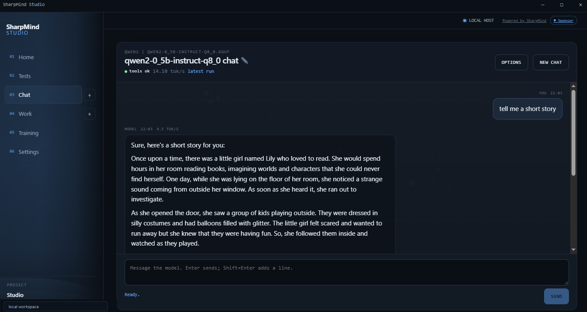

# SharpMind Studio

A local-first workbench for chatting with models, using them on real projects, and
building them: from scratch, from a base model, or by fine-tuning something you
already have.

SharpMind Studio is the front end for the [SharpMind](https://github.com/Integral2u/SharpMind)
libraries and shares their model, tokenizer and run formats. Models, datasets,
sessions and checkpoints stay on your machine until you explicitly send a job to a
compute host or a prompt to OpenRouter.

- **Site and wiki:** <https://integral2u.github.io/SharpMindStudio/>
- **Installer:** <https://github.com/Integral2u/SharpMindStudio/releases/latest/download/SharpMind.Studio.Setup.msi.zip>
- **Source:** <https://github.com/Integral2u/SharpMindStudio>



## Install

Download the Windows installer:
[SharpMind Studio Setup](https://github.com/Integral2u/SharpMindStudio/releases/latest/download/SharpMind.Studio.Setup.msi.zip).
The source path below needs the .NET 10 SDK; the installer is built from the same release.

## Build from source

Requirements: Windows 10/11 and the [.NET 10 SDK](https://dotnet.microsoft.com/).

Source development uses the sibling engine checkout:

```powershell
git clone https://github.com/Integral2u/SharpMind
git clone https://github.com/Integral2u/SharpMindStudio
cd SharpMindStudio
dotnet build SharpMind.Studio.slnx -c Debug
dotnet test  SharpMind.Studio.slnx -c Debug
dotnet run --project SharpMind.Studio
```

In Visual Studio, open **`SharpMind.Studio.slnx`** when the sibling `SharpMind`
checkout is present. It includes the engine projects in the solution, so the IDE
restores and builds them instead of reporting `NU1105` for project references
outside the solution.

A clean Studio-only clone (no sibling engine checkout) uses the package solution:

```powershell
dotnet build SharpMind.Studio.Package.slnx -c Debug -p:SharpMindSource=package
```

Open <http://127.0.0.1:5117>. Add a `.smm` or GGUF model in **Training → Models**,
or connect OpenRouter or a SharpMind Compute host.

## What is in it

| Mode | What it does |
|---|---|
| **Chat** | Local models, OpenRouter or a Compute host; saved sessions, system prompt, tools drawer. |
| **Work** | Project spaces with scoped file/web tools, skills, memory and explicit permissions. |
| **Training** | New model (pretrain), Improve (LoRA/SFT), Playbooks, Data, Runs and Models. |
| **Data Factory** | Source → clean/filter → provider transform → review → chat or text JSONL. |
| **Models** | HuggingFace GGUF browser, resume, `.gguf` → `.smm`, `.smlora` adapters. |
| **Phone pairing** | A phone on your LAN can use Chat and a small Work scope after pairing. |

GPU training is **LoRA fine-tuning only** and needs a LLaMA/Qwen-style base
(RMSNorm + RoPE/NoPE + gated FFN). From-scratch pretraining stays on the CPU. GPU
inference also covers LayerNorm and dense-GELU models, and falls back to the CPU
with a reason in `/health`.

## Compute hosts

A Compute host is the SharpMind server image: one model per process, OpenAI-style
chat on `8080`, the Studio UI on `5117`, and a shared `/data/SharpMind` folder.
Local Docker, Runpod (API deploy) and Vultr or any Linux box (SSH setup) are
supported. The Host card can install Docker and the NVIDIA container toolkit, pull
the image and start or stop the container.

Start here: [Providers](docs/wiki/providers.html) ·
[Local Docker](docs/wiki/local-docker.html) ·
[Runpod](docs/wiki/runpod.html) ·
[Vultr + SSH](docs/wiki/vultr.html).

## Documentation

The wiki is the reference; this README is the short version.

- [Wiki home](docs/wiki/index.html)
- [Models and local chat](docs/wiki/inference.html)
- [HuggingFace](docs/wiki/huggingface.html)
- [OpenRouter](docs/wiki/openrouter.html)
- [Training](docs/wiki/training.html)
- [Work](docs/wiki/work.html)
- [Phone pairing](docs/wiki/pairing.html)
- [Troubleshooting](docs/wiki/troubleshooting.html)
- [Docker runbooks](docker/README.md)

The site is plain HTML under `docs/` and publishes to GitHub Pages; there is no
build step. Open `docs/index.html` directly or serve the folder.

## Security

See [SECURITY.md](SECURITY.md) for the threat model and private reporting.

Provider keys, host tokens and SSH passwords are encrypted with a local key box.
On Windows the key itself is wrapped with DPAPI (current user), so backups restore
only as the same user on the same machine; Linux/Docker keeps owner-only key
files. Pairing tokens are hashed, PINs are salted, and the mobile scope is enforced
by the server. Cross-site browser requests to the admin gateway and Blazor circuit
are rejected using Fetch Metadata. Pairing is a LAN feature; do not forward its
port to the internet.

## License

MIT. See [LICENSE.txt](LICENSE.txt).
